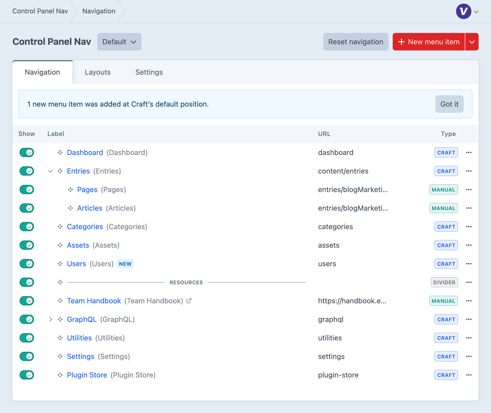

# Navigation

Use the navigation builder to put frequently used tools within easy reach and give menu items names your team recognises. Open **Control Panel Nav → Navigation** as an administrator, then choose the layout you want to edit from the header picker if you have more than one.

## Renaming and Reordering Items

For example, if your team calls its content “Articles”, click the **Entries** label, enter `Articles`, and click **Save**. Choose **Cancel** if you want to leave the name unchanged. You can also open the editor from the row's **Actions → Edit** menu.

Drag the row into its new position. You can place an item beneath another item using the indent action where available, and bring it back to the top level with outdent. The sidebar supports two levels: a top-level item and its children. Dividers cannot contain children.

A saved label takes precedence over the name supplied by Craft or the plugin. Craft and plugin items keep their live URLs. Renaming Entries still takes you to Entries. You cannot change those items' URLs in the builder; create a [manual item](/feature-tour/manual-items) when you need a different destination.

## Showing and Hiding Items

Turn off **Show** beside an item to hide it from the selected layout. Its saved name and position remain available, so you can turn **Show** back on without recreating your changes.

Visibility is separate from access. Craft and plugin items only appear when they are available to the signed-in person. Hiding a link doesn't revoke access to its destination, and showing it doesn't grant access. Use Craft's user permissions to control what editors can access, then test the sidebar with an editor account rather than relying on an administrator's view.

## New Craft or Plugin Items

When Craft or an installed plugin adds a menu item, it appears among its siblings at Craft's default position. The builder displays a notice when there are new items you haven't acknowledged for that layout.

Review the new rows and rename, move, or hide them as needed. Click **Got it** to dismiss the notice. Dismissing it acknowledges the available items; it doesn't remove them from the menu.

## Custom Icons

Custom icons are SVG files in the folder set by [`iconsPath`](/get-started/configuration#iconspath), which defaults to `@webroot/cpnav-icons/`. Suppose you want a branded icon for your Team Handbook link. With the default path, create a `cpnav-icons` folder inside your project's web root, the folder Craft's `@webroot` alias points to. Add your SVG there, for example at `cpnav-icons/brand/mark.svg`. Icons can be in the folder itself or one subfolder, as in this example. Use filenames containing letters, numbers, dots, underscores, or hyphens. The web server must be able to read the folder and file.

Open **Control Panel Nav → Navigation**, choose the intended layout, and edit the Team Handbook item. Select `brand/mark.svg` under **Custom Icon** and click **Save**. Leave the custom icon empty to use the Craft or plugin icon. Reload the control panel to check the icon beside the link.

The item stores `brand/mark.svg` relative to **Icons Path**. Include the icon folder in your deployment so the same relative file exists in every environment. If each environment uses a different absolute folder, configure **Icons Path** for each environment while keeping the folder contents consistent.

If the picker contains no icons, check that **Icons Path** resolves to the folder containing your SVG files and that the web server can read them. If an icon is missing after deployment, check the saved relative path against the deployed folder, then reload the control panel.

## Reset

**Reset navigation** restores the selected layout's menu to Craft and plugin defaults. It removes manual links and dividers, as well as saved names, positions, visibility choices, and custom icons. It keeps the layout itself and its group assignments.

Check the layout picker before clicking **Reset navigation**. The confirmation warns that the action cannot be undone in the builder. Keep a Project Config backup if you may need to restore your work. After confirming, reload the control panel and check that the selected layout shows the default menu available to your account.
